<a href="https://ivebotunac.com">
<picture>
  <source media="(prefers-color-scheme: dark)" srcset="assets/banner-dark.svg">
  
</picture>
</a>

 

I build agentic AI systems, lead partnerships and publish research, 
from LLM-driven trading systems to AI-powered apps with **2 million+ downloads**.

 

 

## Open source

| Repository | What it is | Stars |
| :--- | :--- | :---: |
| **[PrimoAgent](https://github.com/ivebotunac/PrimoAgent)** | Multi-agent stock analysis on LangGraph. Four agents collect market data, run technical analysis, score the news on seven NLP features and turn it into trading signals. |  |
| **[PrimoGPT](https://github.com/ivebotunac/PrimoGPT)** | The code from my PhD. A Transformer model extracts features from financial news, and a deep reinforcement learning agent trades on them. |  |
| **[capacitor-ar-scanner](https://github.com/ivebotunac/capacitor-ar-scanner)** | A Capacitor plugin for LiDAR scanning and real-world measurement on iOS, built to feed AI capture pipelines. |  |
| **[my-academic-papers](https://github.com/ivebotunac/my-academic-papers)** | Code behind my papers since 2017, from LSTM forecasting to fine-tuning versus prompting. |  |

## Research

My PhD at the University of Rijeka built an automated stock trading system on deep reinforcement learning, with language models turning the news into features the agent can learn from. I keep working where language models meet decisions.

Most cited:

- **Optimization of Traditional Stock Market Strategies Using the LSTM Hybrid Approach** Information, 2024 · [doi:10.3390/info15030136](https://doi.org/10.3390/info15030136)
- **Opportunities of Gen AI in the Banking Industry with regards to the AI Act, GDPR, Data Act and DORA** MECO, 2024 · [doi:10.1109/MECO62516.2024.10577936](https://doi.org/10.1109/MECO62516.2024.10577936)
- **Comparing Fine-Tuning and Prompt Engineering for Multi-Class Classification in Hospitality Review Analysis** Applied Sciences, 2024 · [doi:10.3390/app14146254](https://doi.org/10.3390/app14146254)
- **Analysis of Software Threats to the Automatic Identification System** Brodogradnja, 2017 · [doi:10.21278/brod68106](https://doi.org/10.21278/brod68106)
- **The Effect of Feature Selection on the Performance of LSTM Neural Networks in Stock Market Predictions** DAAAM Symposium, 2020 · [doi:10.2507/31st.daaam.proceedings.081](https://doi.org/10.2507/31st.daaam.proceedings.081)

All ten papers are on [Google Scholar](https://scholar.google.com/citations?user=Yr-Z7D0AAAAJ).

## Now

- **[ALFATEC Group](https://alfatec.ai)**, Zagreb · Director of Partnerships, AI on European Defence Fund projects
- **[CroAI](https://croai.org)** · Board President of the Croatian AI Association
- **[Stockifi](https://stockifi.io)**, Oslo · AI Research Engineer on agents that read supplier invoices for 500+ restaurants
- **[Martian & Machine](https://www.martian-machine.ai)**, Berlin · AI Research Engineer on autonomous coding agents for an enterprise client
- **[Primo Technology](https://techprimo.ai)**, Zadar · Founder of an indie studio with 13 AI-powered apps

Before that I founded Sintelly, an app that pairs AI with cognitive behavioural therapy and passed 1.5 million downloads.
